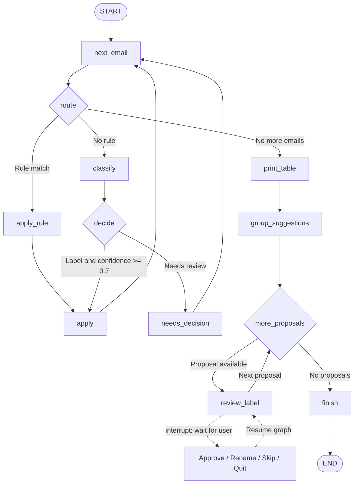

<div dir="rtl">

# Email Tags Agent

**סוכן AI לסיווג וארגון מיילים ב-Gmail, עם כללים דטרמיניסטיים, סיווג מבוסס Claude ואישור אנושי לפני יצירת תגיות חדשות.**

הסוכן מעבד את המיילים שהתקבלו היום בתיבת הדואר הנכנס, מתאים להם תגיות קיימות, ומזהה קבוצות של מיילים שאינן מתאימות לתגיות הקיימות. במקרים כאלה הוא מציג הצעות לתגיות חדשות וממתין לאישור לפני יצירתן.

הפרויקט מבוסס על **LangGraph**, **LangChain**, **Claude**, **Gmail API** ו-**LangSmith**. ניתן להריץ אותו מהטרמינל או דרך ממשק Streamlit.

> **גישה בטוחה כברירת מחדל:** ההרצה מתחילה במצב `dry-run`. גם בהרצה שמבצעת שינויים, הסוכן מוסיף תגיות בלבד — הוא אינו מוחק, מעביר לארכיון, מעביר לאשפה, שולח מיילים או מסיר תגיות.

---

## תוכן עניינים
- [איך זה עובד](#איך-זה-עובד)
- [ארכיטקטורת LangGraph](#ארכיטקטורת-langgraph)
- [עקרונות התכנון](#עקרונות-התכנון)
- [מבנה הפרויקט](#מבנה-הפרויקט)
- [התקנה והגדרה](#התקנה-והגדרה)
- [הרצה](#הרצה)
- [הערכה עם LangSmith](#הערכה-עם-langsmith)
- [תובנות ומסקנות שהגעתי אליהם במהלך הפיתוח](#תובנות-ומסקנות-מהפיתוח)
- [פרטיות ובטיחות](#פרטיות-ובטיחות)
- [בדיקות](#בדיקות)
- [מגבלות ידועות](#מגבלות-ידועות)
- [כיוונים להמשך](#כיוונים-להמשך)
---

## איך זה עובד

הסוכן משלב שני מסלולי סיווג: כללים קבועים למקרים שניתן לזהות בוודאות, ומודל שפה למקרים שדורשים הבנת הקשר.

### תהליך העיבוד

1. **טעינת מיילים** — שליפת המיילים של היום מתיבת הדואר הנכנס, למעט מיילים שכבר סומנו בתגית `AI-Processed`.
2. **בדיקת כללים** — בדיקה אם כתובת של אחת מקבוצות Google מוגדרת מופיעה בין הנמענים (`To`,‏ `Cc` או `List-Id`). אם נמצאה התאמה, נבחרת התגית שהוגדרה לכלל.
3. **סיווג באמצעות Claude** — מיילים שלא התאימו לכלל נשלחים למודל יחד עם השולח, הנושא, תקציר קצר ורשימת התגיות הזמינות.
4. **החלטה לפי רמת הביטחון** — תגית קיימת עם ציון ביטחון של `0.7` ומעלה מתאימה להחלה אוטומטית. תוצאה שאינה עומדת בתנאי מועברת להמשך בדיקה.
5. **ריכוז הצעות** — מיילים שממתינים להחלטה מקובצים לפי תגיות קיימות, ובנפרד נשלחת קריאה נוספת למודל כדי לקבץ מיילים שלא נמצאה להם תגית מתאימה.
6. **אישור אנושי** — הסוכן מציג כל הצעה בנפרד וממתין להחלטה: אישור, שינוי שם (בהצעה לתגית חדשה), דילוג או דילוג על יתר ההצעות.
7. **עדכון התגיות** — רק לאחר אישור נוצרת תגית חדשה ב-Gmail, מתווספת לקובץ `labels.yaml`, ומוחלת על המיילים הרלוונטיים.

### דוגמה לשלב הסקירה

הדוגמה הבאה משתמשת במיילים מומצאים:

```text
────────────────────────────────────────────────────────────
Proposed new label 1 of 2:  Job alerts
Description: Job-board digests and recruiter notifications.
Emails (3):
  • 5 new jobs for you this week           | alerts@jobs.example
  • A recruiter viewed your profile        | notify@careers.example
  • Weekly openings near you               | digest@jobs.example
[a] approve   [r] rename   [s] skip   [q] skip all remaining  >
```

---

## ארכיטקטורת LangGraph

ה-workflow בנוי משתי לולאות עיקריות:

- **לולאת עיבוד המיילים:** עוברת על המיילים אחד-אחד, מנתבת כל מייל למסלול הכללים או למסלול המודל, ומחליטה אם להחיל תגית או להמתין להחלטה.
- **לולאת סקירת ההצעות:** עוברת על ההצעות אחת-אחת. הצומת `review_label` משתמש ב-`interrupt()` כדי לעצור את הגרף עד לקבלת החלטה מהמשתמשת.



### הצמתים המרכזיים

| צומת | אחריות |
|---|---|
| `next_email` | בחירת המייל הבא לעיבוד |
| `route` | ניתוב לפי התאמה לכלל או סיום רשימת המיילים |
| `apply_rule` | יצירת תוצאת סיווג על בסיס כלל קבוע |
| `classify` | סיווג המייל באמצעות Claude |
| `decide` | החלטה אם רמת הביטחון מאפשרת החלה אוטומטית |
| `apply` | הוספת התגית ותגית `AI-Processed` |
| `needs_decision` | שמירת המייל להמשך סקירה |
| `print_table` | הצגת טבלת תוצאות הסיווג |
| `group_suggestions` | יצירת הצעות לתגיות קיימות וחדשות |
| `review_label` | עצירת הגרף לקבלת החלטה אנושית |
| `finish` | סיום התהליך והצגת סיכום |

### State וניהול הריצה

הגרף משתמש ב-`State` שמוגדר כ-`TypedDict` בקובץ `models.py`, ובמודלי Pydantic עבור נתוני המיילים, תוצאות הסיווג וההצעות. ב-State נשמרים בין היתר המיילים, תוצאות הסיווג, המיילים שממתינים להחלטה, ההצעות ומיקום הסקירה.

שדות רשימה מצטברים, כגון `results`,‏ `applied`,‏ `pending` ו-`decisions`, משתמשים ב-`operator.add`.

כדי לאפשר עצירה והמשך באותה ריצה, הגרף מתקמפל עם `InMemorySaver` כ-checkpointer. לכל הרצה נוצר `thread_id` ייחודי, והוא נשמר גם בעת חידוש הגרף לאחר `interrupt()`.

---

## עקרונות התכנון

### 1. כללים לפני LLM

לא כל מייל צריך מודל שפה. מיילים שמגיעים לקבוצות Google מוגדרות מטופלים באמצעות התאמה של כתובת הנמען לכלל קבוע. כך נמנעת קריאת מודל במקרים שבהם ניתן לקבל החלטה באמצעות כלל מפורש.

תגיות שמוגדרות עם `rule_only: true` אינן נשלחות למודל, ולכן המודל אינו יכול לבחור בהן.

### 2. סיווג לפי סוג המייל

המודל מתבקש לזהות את **סוג המייל** ולא להסתמך רק על השולח או על הנושא. לדוגמה, קבלה אינה אמורה להפוך לפרסומת רק משום שהיא כוללת הטבה, וסיכום של קהילה אינו בהכרח ניוזלטר טכנולוגי.

אם אף תגית אינה מתאימה בבירור, המודל מתבקש להשאיר את המייל ללא תגית במקום לכפות התאמה.

### 3. Confidence threshold

כל תוצאת סיווג כוללת ציון ביטחון בין `0` ל-`1`.

- תגית קיימת עם ביטחון של `0.7` ומעלה עוברת למסלול ההחלה.
- תוצאה עם ביטחון נמוך יותר, או ללא תגית מתאימה, עוברת למסלול הסקירה.

### 4. Human-in-the-Loop

הצעות לתגיות חדשות אינן מיושמות באופן עצמאי. הגרף נעצר באמצעות `interrupt()` וממתין לתשובה לפני שהוא ממשיך.

בהצעה לתגית חדשה אפשר לאשר, לשנות את שמה, לדלג עליה או לדלג על כל ההצעות שנותרו. הצעה לתגית קיימת מאפשרת אישור או דילוג.

### 5. מניעת עיבוד כפול

התגית `AI-Processed` משמשת כסימון למיילים שהסוכן כבר טיפל בהם. בשליפה הבאה מיילים שסומנו כך אינם מעובדים שוב.

מיילים שלא הוצעה להם תגית — למשל משום שהקבוצה שלהם קטנה מהמינימום שנקבע — יכולים לקבל את סימון העיבוד בלבד.

---

## מבנה הפרויקט

```text
email-tags-agent/
│
├── email_agent/
│   ├── main.py                 # נקודת כניסה ל-CLI וניהול הריצה
│   ├── graph.py                # הגדרת הגרף, הצמתים והקשתות
│   ├── nodes.py                # לוגיקת הצמתים, הסיווג והכללים
│   ├── models.py               # מודלי Pydantic וה-State של הגרף
│   ├── config.py               # הגדרות וטעינת קובצי YAML
│   ├── gmail_client.py         # תקשורת עם Gmail API
│   ├── labels.yaml             # הגדרות התגיות
│   ├── rules.example.yaml      # דוגמה להגדרת כללים לפי כתובות קבוצות
│   ├── app.py                  # ממשק Streamlit
│   ├── ui_*.py                 # רכיבי ממשק Streamlit
│   ├── evals/                  # ניסויי הערכה ב-LangSmith
│   └── tests/                  # בדיקות יחידה
│
├── .streamlit/
├── requirements.txt
└── README.he.md
```

---

## התקנה והגדרה

### דרישות מקדימות

- Python 3.11 ומעלה
- חשבון Gmail
- מפתח API של Anthropic
- מפתח API של LangSmith

### 1. שכפול הפרויקט והתקנת התלויות

```bash
git clone https://github.com/lea-shtul/email-tags-agent.git
cd email-tags-agent

python -m venv .venv
.venv\Scripts\activate

pip install -r requirements.txt
```

### 2. הגדרת משתני סביבה

יש ליצור קובץ `.env` בתיקיית השורש:

```env
ANTHROPIC_API_KEY=your_anthropic_api_key
LANGSMITH_API_KEY=your_langsmith_api_key
LANGSMITH_TRACING=true
LANGSMITH_PROJECT=email-tags-agent
```

אין להעלות את הקובץ ל-Git.

### 3. חיבור ל-Gmail

1. יוצרים פרויקט ב-Google Cloud Console.
2. מפעילים בפרויקט את Gmail API.
3. יוצרים OAuth Client מסוג **Desktop app**.
4. שומרים את קובץ פרטי ההתחברות בשם `credentials.json` בתיקיית השורש.
5. מריצים את הסוכן ומבצעים את תהליך ההתחברות הראשוני. התהליך יוצר את `token.json`.

הסוכן משתמש בהרשאת OAuth מסוג `gmail.modify`.

### 4. הגדרת כללים לקבוצות

מעתיקים את:

```text
email_agent/rules.example.yaml
```

לקובץ:

```text
email_agent/rules.yaml
```

ומעדכנים בו את כתובות קבוצות Google ואת התגיות המתאימות להן.

הקובץ `rules.yaml` האישי אינו מיועד להעלאה ל-Git.

---

## הרצה

### הרצה מקדימה — Dry Run

זוהי ברירת המחדל. הסוכן מציג מה היה עושה, בלי לשנות את Gmail:

```bash
.venv\Scripts\python email_agent\main.py
```

אפשר לציין במפורש:

```bash
.venv\Scripts\python email_agent\main.py --dry-run
```

### הגבלת מספר המיילים

```bash
.venv\Scripts\python email_agent\main.py --limit 10
```

### החלת תגיות בפועל

```bash
.venv\Scripts\python email_agent\main.py --apply
```

במצב זה הסוכן מוסיף תגיות ב-Gmail. הוא אינו מסיר תגיות או מבצע פעולות אחרות בתיבת הדואר.

### ממשק Streamlit

```bash
.venv\Scripts\streamlit run email_agent\app.py
```

הממשק כולל גם מצב דמו עם מיילים מומצאים, שאינו נוגע בחשבון Gmail.

---

## הערכה עם LangSmith

הסיווג נבדק באמצעות Dataset של **39 מקרי בדיקה עם מיילים מומצאים**. כל מקרה הורץ שלוש פעמים, ובסך הכול התקבלו 117 תוצאות בכל ניסוי.

נבדקו שני מדדים:

- **`label_match`** — האם המודל בחר בתגית הצפויה, או השאיר את המייל ללא תגית כאשר זו הייתה התשובה הנכונה.
- **`confident_match`** — האם המודל גם בחר בתגית הצפויה וגם החזיר ציון ביטחון של `0.7` ומעלה. זהו המדד שמתאים להחלטה אם להחיל תגית באופן אוטומטי.

### תוצאות הניסויים

| ניסוי | `label_match` | `confident_match` |
|---|---:|---:|
| Baseline | 88.9% (104/117) | 78.6% (92/117) |
| ניסיון 1 — שינוי פרומפט | 86.3% | 82.9% |
| ניסיון 2 — פרומפט מדויק יותר | **97.4% (114/117)** | **89.7% (105/117)** |

בניסיון השני שונה הפרומפט מהנחיה כללית לבחור את התגית הקרובה ביותר, להנחיה שממקדת את ההחלטה בסוג המייל. נוספו דוגמאות והודגש שאם אף תגית אינה מתאימה בבירור, יש להשאיר את המייל ללא תגית.

### הרצת ניסוי

```bash
.venv\Scripts\python email_agent\evals\run_experiment.py --name <experiment-name>
```

> **חשוב בפרשנות התוצאות:** מקרי הבדיקה הקשים נוספו לאחר שנצפו כשלים ב-Baseline, והפרומפט כוונן על אותו Dataset. אין Dataset נפרד לבדיקת הכללה, ולכן תוצאת 97.4% אינה מדד בלתי תלוי לביצועי המודל בעולם האמיתי.

---

## פרטיות ובטיחות

- למודל נשלחים נושא המייל, השולח ותקציר קצר (`snippet`) — לא גוף המייל המלא.
- כתובות הנמענים משמשות להתאמת כללים ואינן נשלחות למודל.
- מסנן ה-traces של LangSmith (`hide_inputs` ו-`hide_outputs`) מצמצם מידע רגיש לפני העלאתו: מיילים שהתאימו לכלל מצטמצמים ל-ID ולתגית, וכתובות נמענים מוסרות.
- הפרומפט ליצירת הצעות אוסר לכלול שמות אנשים או כתובות בשמות ובתיאורי התגיות.
- כל הצעה לתגית חדשה מוצגת לאישור לפני יצירתה.
- הקוד משתמש בפעולות Gmail להוספת תגיות בלבד. בדיקת יחידה מוודאת שאין שימוש בפעולות מחיקה, העברה לאשפה, שליחה או הסרת תגיות.
- קובצי סודות והגדרות אישיות — `.env`,‏ `credentials.json`,‏ `token.json` ו-`rules.yaml` — אינם מיועדים להעלאה ל-Git.

---
## תובנות ומסקנות שהגעתי אליהם במהלך הפיתוח

בניסוי השני הגעתי ל־**97.4% התאמה** לתוצאות המצופות, שיפור משמעותי לעומת ה־Baseline שעמד על 88.9%.

עם זאת, שיעור ההתאמה של `confident_match`- כמה אחוזים מתוך המיילים הוא היה בטוח בהתאמה של התווית: עמד על **89.7% בלבד**, משום שלא כל הסיווגים הנכונים עברו את סף הביטחון שהוגדר (0.7).

למרות השיפור בדיוק הסיווג, בחרתי שלא להוריד את סף הביטחון כדי להגדיל את כמות התיוגים האוטומטיים . הסיבה היא שהמודל נבחן על מקרי בדיקה מוגדרים מראש, ולא ניתן להניח שכל מייל עתידי יתאים באותה מידה למקרים שעליהם נבדק. לכן אני מעדיפה להשאיר את מנגנון הסינון שמרני, ולא להסתכן בתיוג אוטומטי של מיילים שהמודל אינו בטוח מספיק בסיווג שלהם.

## בדיקות

להרצת בדיקות היחידה:

```bash
.venv\Scripts\python -m unittest discover -s email_agent\tests -v
```

---

## מגבלות ידועות

- מקרי הבדיקה כווננו על אותו Dataset שעליו נמדדו התוצאות, ולכן המדדים עלולים להיות אופטימיים.
- ציון הביטחון במקרה שבו המודל קובע שאף תגית אינה מתאימה נוטה להיות סביב `0.6`; זה אינו מדד הסתברות מכויל.
- הסוכן קורא רק מיילים שהתקבלו היום, ולכן מתאים להרצה יומית.
- תוצאות המודל עשויות להשתנות מעט בין הרצות.

---

## כיוונים להמשך

- הרצות מתוזמנות — ידרשו checkpointer קבוע ופקודת סקירה נפרדת.
- פריסה בענן — תדרוש טיפול נוסף ב-OAuth ובאבטחה.
- הוספת אפשרות `--days` לעיבוד מיילים מטווח רחב יותר.

---

</div>
